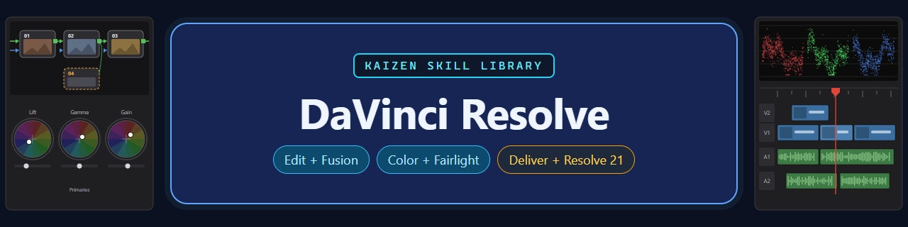

# DaVinci Resolve Agent Skill



Gives Claude Code, Codex and other coding agents the DaVinci Resolve 20.3 Reference Manual and the Resolve 21 New Features Guide as 1,191 topic pages, so they can answer with the page, control names, menu paths and conditions Resolve uses for editing, Fusion, color, Fairlight audio and delivery.

**Status: early draft.** The reference pages are in place; scripts, assets and evaluations will be added over time.

## Install

```sh
npx skills add LevyBytes/AI-SKILL-davinci-resolve -g
```

This installs the skill as `davinci-resolve` for each coding agent it finds on your computer; without `-g` it goes into the current project only. The command needs Node.js 22.20 or later.

<details>
<summary>Install without Node.js</summary>

Clone the repository into your agent's skills folder:

| Agent | Command |
| --- | --- |
| Claude Code | `git clone https://github.com/LevyBytes/AI-SKILL-davinci-resolve ~/.claude/skills/davinci-resolve` |
| Codex | `git clone https://github.com/LevyBytes/AI-SKILL-davinci-resolve ~/.agents/skills/davinci-resolve` |

</details>

## Use

Ask your agent about DaVinci Resolve as usual; it loads the skill when a task matches. You can also call it by name with `/davinci-resolve` in Claude Code or `$davinci-resolve` in Codex.

- "Which composite operators does the Fusion Merge node offer, and what do its inputs do?"
- "How is a DCTL `transform` function declared, and why does it need `__DEVICE__`?"
- "What do the Proxy Format settings in Blackmagic Proxy Generator control?"
- "Which panels and albums does the Resolve 21 Photo page have?"

## What's inside

| Area | Pages | Covers |
| --- | ---: | --- |
| [Interface and setup](references/getting-started/INDEX.md) | 24 | Interface controls, preferences, control panel setup |
| [Projects and collaboration](references/projects/INDEX.md) | 36 | Projects, project libraries, Blackmagic Cloud, review integrations, collaboration |
| [Media and ingest](references/media/INDEX.md) | 39 | Importing, organizing, syncing and describing source media |
| [Proxies and performance](references/performance/INDEX.md) | 9 | Proxies, Blackmagic Proxy Generator, render and node caching, playback |
| [Color management and HDR](references/color-management/INDEX.md) | 35 | Camera RAW decoding, RCM and ACES, working color spaces, HDR, output transforms |
| [Cut page](references/cut/INDEX.md) | 44 | Assembling and trimming a program on the Cut page |
| [Edit page](references/edit/INDEX.md) | 84 | Timelines, track selection, trimming, multicamera editing |
| [Timeline effects and titles](references/timeline-effects/INDEX.md) | 35 | Transitions, titles, subtitles, compositing, speed effects |
| [Conforming and interchange](references/conforming/INDEX.md) | 20 | Importing and relinking edits, interchange format support |
| [Fusion workflows](references/fusion/INDEX.md) | 169 | Compositing, animation, tracking, paint, particles |
| [Fusion nodes and modifiers](references/fusion-nodes/INDEX.md) | 295 | Each Fusion node's inputs and parameters, and the modifiers |
| [Color grading](references/color/INDEX.md) | 112 | Grading, grade management, qualifiers, color node graphs |
| [Resolve FX](references/resolve-fx/INDEX.md) | 76 | Choosing and configuring Resolve FX effects |
| [Fairlight audio](references/fairlight/INDEX.md) | 103 | Recording, editing, mixing, routing and automation |
| [Delivery and export](references/delivery/INDEX.md) | 28 | Rendering, export, burn-in metadata, delivery packages |
| [Immersive and stereo video](references/immersive-and-stereo/INDEX.md) | 19 | Apple Immersive and stereoscopic video |
| [Integration and live grading](references/integration/INDEX.md) | 9 | DCTL, workflow integrations, transport control, Resolve Live |
| [Menu reference](references/menus/INDEX.md) | 14 | Documented menu commands |
| [Resolve 21 new features](references/resolve-21/INDEX.md) | 39 | The Photo page, AI tools, editing, color, compositing and audio additions in Resolve 21 |

The Resolve 21 area comes from the separate New Features Guide; a Resolve 21 feature does not mean it exists in 20.3. The [version and scope guidance](references/reading-versioned-references.md) explains what to check before applying a procedure.

## When agents load this skill

Use when working in DaVinci Resolve: Media, Cut, Edit, Fusion, Color, Fairlight, Deliver, or the Resolve 21 Photo page; media/proxies, timelines, trimming, transitions, titles, grading, RCM/ACES/LUTs, nodes, Resolve FX, audio, rendering, project libraries, Blackmagic Cloud, collaboration, immersive workflows, DCTL or transport controls. Covers the Resolve 20.3 Reference Manual and the Resolve 21 New Features Guide. Not for other editing or audio applications.

## The work behind the references

Manual material is interpreted into page and workflow categories with descriptive topic names. Controls, shortcuts and procedure conditions remain associated with their subject, while the Resolve 21 additions have a separate reference area.

## Contributing

Pull requests are accepted from approved contributors only. To propose a fix or a feature, first open an issue that describes the change your pull request would make, such as a page that is wrong or out of date and the Resolve manual section it should match. The maintainer reviews the issue and your GitHub account, then approves or declines. New maintainers are approved the same way. See [CONTRIBUTING](.github/CONTRIBUTING.md).

## Sources and license

Skill reference documentation is interpreted content for use in open source projects. Check against [official documentation sources](https://www.blackmagicdesign.com/support/family/davinci-resolve-and-fusion) when dealing with defects or issues that may come up from interpreting this skill's references.

Licensed under **Apache-2.0**; see [LICENSE](LICENSE). Part of the [Agent Kaizen](https://github.com/LevyBytes/agent-kaizen) skill library.
